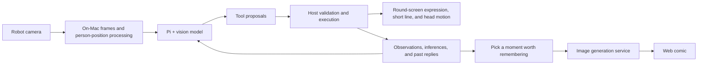

[中文](README.md) | English

https://github.com/user-attachments/assets/eadb1c1a-6a71-452c-96b9-f990ef125846

*18-second introduction: companionship, records, and moments worth remembering.*

# Desktop Companion

**You don't have to speak first. It notices you, and it remembers what just happened.**

Open-sourced by [Shenzhen Linght Technology Co., Ltd. (深圳光泊科技有限公司)](https://linght.com/) (Linght / 光泊) · Official introduction: [Linght Lab · Desktop Companion](https://linght.com/en/lab.html)

A silent companion robot that sits on your desk. While you work, read, or glance at your phone, it watches through its own camera and responds with eye expressions, a slight turn of the head, and a short line of text. It keeps the clips it actually saw together with its own replies, then draws the moments worth remembering as comics.

[Watch the on-device demo](https://github.com/linght-base/desktop-companion/releases/download/v0.1.0/desktop-companion-real-demo.mp4) · [Download the full project package](https://github.com/linght-base/desktop-companion/releases/download/v0.1.0/desktop-companion-v0.1.0.zip) · [Install notes](INSTALL.md) · [What it is built on](#what-it-is-built-on)

## On-device demo

https://github.com/user-attachments/assets/d2e25285-cc12-4b18-bf37-aabc457fcaa7

**The video above plays in place.** About 41.5 seconds. It keeps the actual motion and response timing, with no intro or credits. The computer screen beside the robot is cropped out; live audio is kept. The 18-second clip explains the experience; treat this recording as the reference for how the robot looks and actually responds.

## Companionship, records, and memory

The next three parts introduce the features: Companionship and Records use console screenshots as examples; Memory shows comics actually generated in Worth Remembering. The comics are illustrations based on the records; for real-device motion and responses, see the video above. The screenshots below keep the same frames as the Chinese README, with English UI labels. The running console is still Chinese.

### Companionship: you don't have to speak first, and it still responds

Go about your own work. It pays attention to you and what is nearby, and responds with eye expressions, a slight head turn, and a short line of text. Once it finds a person, it tries to stay at a suitable position; if it cannot see anyone for a while, it rests and checks again on a timer. The robot does not currently use voice conversation.


### Records: keep what it saw and what it said

Companionship Records puts the clips it saw together with the feedback it gave you at the time, so you can look back. The latest five entries are shown by default and can be expanded. If it got something wrong, you can correct or retract it. Gaps with nothing seen stay blank; a few sampled frames are not written up as a continuous experience.


### Memory: keep a moment worth remembering as a drawing

A raised hand, a pause in work, leaning back in the chair for a breath. An ordinary moment is still worth keeping.

Every half hour, it tries to pick a moment from records that have a basis, draw it as a comic, and send you a line of encouragement. You can browse them anytime in Worth Remembering. Up to five recent comics are shown, and you can also generate one manually. If there is no reliable clip yet, it stays blank.


The comics are illustrated from the companionship records; people and details may differ from the scene. Past observations and replies also feed later understanding, so the companionship can continue from where it left off.

## What you can do in the console

The console UI is currently in Chinese. The labels below match the pages you will see.

| Page | What you can do |
| --- | --- |
| Intro video (介绍视频) | Watch the short introduction film |
| Initial setup (初始化设置) | Connect the robot, fill in the model service, model name, and API key, and check connection status |
| Companionship (陪伴) | Start or stop companionship; view the robot camera, eyes, and the feedback it gives you |
| Worth Remembering (值得回忆) | View or manually generate comics |
| How It Understands You (如何理解你) | View what it has inferred, the supporting basis, the actual prompts, and context |
| Companionship Records (相处记录) | View past observations and replies; correct or retract mistakes |

## What it is built on

The agent core uses **[Pi Agent Core](https://github.com/earendil-works/pi)**. Pi handles model conversation, tool calls, and the reasoning loop. Around it, this project implements perception, memory, event scheduling, expression, and device execution.

Robot capabilities come through the **[WatcherRobot Python SDK](https://github.com/orulink-ai/WatcheRobot_python_sdk)**. The app runs on a Mac and connects to the robot through the official app channel. Large-model inference and comic image generation call the model services you configure.

### Where each part runs

| Where | What runs | What you need |
| --- | --- | --- |
| Robot | Camera, round-screen expressions and short lines, head motion | The robot's existing system and official Desktop / SDK connection; this project does not include robot firmware |
| Your Mac | Pi Agent, memory store, person-position detection, web console, and device bridge | This project, Node, Python, and the official SDK; the computer and project process must keep running during companionship |
| The model service you choose | Image understanding, agent model inference, comic image generation | Your own service URL, model, and API key; you do not deploy a separate cloud server for this project |

Downloading the project package does not include a model account or large-model weights, and it is not a setup where you install everything onto the robot and then unplug the computer.

| Part | What it actually uses | Role in this project |
| --- | --- | --- |
| Agent | `@earendil-works/pi-agent-core` **1.4.0** | Native agent loop, tool calls, interrupt and resume |
| Model adapter | `@earendil-works/pi-ai` **1.4.0** | Compatible model calls, image input, and streaming responses |
| Tool parameters | `typebox` **1.3.27** | Validation for tool parameters and data structures |
| Robot | `watcherobot`, verified here at **0.1.10** | Official app launch, connection, camera, screen, head motion, and shutdown |
| Local service | Node.js, minimum **22.19.0** | Console APIs, events and scheduling, Pi host, device bridging |
| Web | HTML, CSS, vanilla JavaScript | Six-page console, expression simulation, and user actions |
| Device bridge | Python **3.11** | Robot SDK calls, frame processing, Chinese glyphs, and execution receipts |
| Memory | Node built-in SQLite / FTS | Store observations, experiences, inferences, and text context; retrieve and revise by source |
| Person position | OpenCV YuNet | Local short-term face position and orientation cues; no identity enrollment |
| Frame processing | aiortc, PyAV, Pillow, OpenCV | Receive and process the robot's live video, occlusions, sampling, and screen drawing |

How a run actually flows:



Personality and behavior prompts live in `apps/companion-sim/config/`. Observations, feedback, and related memory enter a bounded context and are compressed when they reach a threshold. Text context can be saved and restored; raw image context stays in memory only. Inferences have a supporting basis and a revision state. Model output still needs host validation before any device action is executed.

Memory retrieval uses full-text search and relevance ranking on local SQLite. There is no extra vector database or embedding-service dependency. “Remembering” here means saving and retrieving real observations, inferences, and feedback. The persona comes from inspectable prompts; the project does not currently change model weights through online training.

## What you need before you start

| Requirement | Details |
| --- | --- |
| Computer | **Mac**; the current release only claims macOS support |
| Robot | WatcherRobot, able to enter the Desktop / Python SDK connection UI; camera, round screen, and head working |
| Node.js | **Node 24** recommended, minimum **22.19.0**; uses Node's built-in SQLite |
| Python | **Python 3.11** recommended; install the SDK and a separate frame-processing environment |
| Browser | A modern browser; the current console was verified in Chrome |
| Network | The computer can reach the robot and the chosen AI service; first install downloads public dependencies and the YuNet model |
| Model account | A usable API key; the model must support **image input and tool calls**; service usage may be billed |
| Comic service | MiniMax image generation needs the matching service permission; configuring a vision model is not the same as having permission to draw comics |

This machine does not run vision-LLM weights locally; inference is delegated to the configured service. The project has not published strict minimum memory, CPU, or long-load figures. Being able to run on a developer machine is not the same as having verified every Mac.

### Pinned Python frame-processing dependencies

`config/integration/companion-webrtc.requirements.txt` pins the versions below. The prepare script installs them into the project's own isolated environment:

| Dependency | Version |
| --- | --- |
| aiortc | 1.15.0 |
| PyAV (`av`) | 17.1.0 |
| Pillow | 12.1.0 |
| opencv-python-headless | 4.12.0.88 |
| numpy | 2.2.6 |

The person-position model is `face_detection_yunet_2023mar.onnx`. On first prepare it is downloaded from OpenCV Zoo and checked for size and SHA-256. Source and license notes are in `config/integration/companion-sight-model.json` and the license file in the same directory.

## Install and start

Run the following commands in the **unzipped project directory**. For a typical try-out, download the [full project package](https://github.com/linght-base/desktop-companion/releases/download/v0.1.0/desktop-companion-v0.1.0.zip) from the Release; it already includes the images and introduction video you can use directly. A longer install walkthrough is in [`INSTALL.md`](INSTALL.md) (currently Chinese).

### 1. Prepare the environment

Install Node 24 and Python 3.11 first, and confirm the terminal can run:

```sh
node --version
python3.11 --version
```

Create the Python environment used by the SDK and install dependencies:

```sh
python3.11 -m venv .venv
.venv/bin/python -m pip install "watcherobot==0.1.10" "Pillow>=12,<13"
.venv/bin/python prepare.py
```

`prepare.py` installs the locked Node dependencies, creates a separate frame-processing environment, downloads and checks the YuNet model, and saves the Node path. It does not connect to the robot, call a model, or bring in the author's keys or companionship records.

### 2. Start from the official entry

Connect the robot with WatcherRobot first, keep it on the Desktop / Python SDK screen, then run:

```sh
.venv/bin/watcherobot app check .
.venv/bin/watcherobot app run .
```

You can also start an installed “桌面伙伴” (Desktop Companion) from the WatcherRobot app entry. `app.py` needs the app channel injected by the official launcher, so use the entry above and do not run `python app.py` directly.

Open <http://127.0.0.1:8794/>. If the port is still held by an old process, stop that copy of the project explicitly, then start this one.

### 3. Finish initial setup

On the Initial setup (初始化设置) page:

1. Confirm the robot is connected; enter the robot's current six-digit pairing code if needed.
2. Choose a model service and fill in the service URL, model name, and API key.
3. Click Save and apply (保存并生效). Saving pauses companionship. A saved key is not filled back in; leave the field empty to keep it, or type a new value to replace it.
4. Go to the Companionship (陪伴) page and click Start (启动). The robot turns on its own camera and hands the frames to the configured model.

Before you start, move anything you do not want to share out of the camera view. You can also set on-screen occlusions if needed. Occlusions limit autonomous head motion so the camera does not turn and misalign the mask.

## How to configure the model

Default service configuration for this release:

| Setting | Value |
| --- | --- |
| Provider | MiniMax |
| Base URL | `https://api.minimax.cn/v1` |
| Vision and agent model | `MiniMax-M3.1-Flash-Preview` |
| Image generation model | `image-01` |
| API key | Use your own account; it is not shipped with the project |

You can also fill in an OpenAI-compatible service in the UI. That service and the chosen model need to support image input, tool calls, and the compatible protocol this project uses. Filling in an arbitrary text model is not enough for the full experience. The MiniMax path has its own inference-parameter adapter; other services need you to confirm compatibility.

Comic image generation currently uses the MiniMax adapter. You can reuse a MiniMax key on the same service URL. If you switch to another vision service, configure the comic service separately. Advanced configuration supports:

- `COMPANION_MODEL_PROVIDER`, `COMPANION_MODEL_BASE_URL`, `COMPANION_MODEL_ID`, `COMPANION_MODEL_API_KEY`: main model service.
- `COMPANION_IMAGE_API_KEY`, `COMPANION_IMAGE_BASE_URL`, `COMPANION_IMAGE_MODEL`: comic image service.
- `COMPANION_NODE_PATH`: explicit Node executable.
- `COMPANION_DATA_DIR`: explicit data directory for this project.

Set these variables in the runtime environment of the launching process. For a first try, prefer the web settings. A successful save only means the settings took effect, not that the model connection has been verified.

## Everyday use

You do not need to assign it tasks. Do what you normally do, and notice the eyes, head motion, and short lines of text.

- **Look at comics:** Open Worth Remembering (值得回忆), or click Draw a recent moment (画出最近的瞬间). Generation takes time. The images are illustrations based on the records; details may differ from the scene.
- **See what it remembered:** Open How It Understands You (如何理解你) and Companionship Records (相处记录) to view inferences, supporting basis, and earlier replies. If it got something wrong, correct or retract it.
- **Take a break:** Click Stop (停止), then Start (启动) when you come back.
- **End for the day:** Click Stop (停止), or press Esc. Stopping the project from WatcherRobot also exits the programs this project started.

**Closing the web page alone does not stop on-device companionship. Click Stop (停止) before you leave.**

## Where data is stored

With the official launch path, data is stored by default in this local user directory:

```text
~/Library/Application Support/WatcherRobot/desktop-companion/
├── settings.json       # Model config and API keys
├── runtime.json        # Confirmed Node path
└── companion.sqlite    # Companionship records, inferences, text context, comics, and related data
```

Config files use restricted permissions. Raw video is not kept as a continuous recording. The short image window needed for model requests stays in memory. Once sharing is enabled, the chosen model service receives the related frames and text context; how that service processes and retains them follows its own terms. The robot's microphone audio is not captured.

Do not put this user data directory, model keys, the database, or private comics into a public code repository. The project package and the public repository do not ship that data.

## Project layout and development entry points

```text
app.py / app.json                Official app entry and description
launcher.py / host.mjs            Python launch supervisor and local Node service
managed_device.py                Official app channel and device bridge
prepare.py                       First-time prepare and local config
apps/companion-sim/
├── src/agent.mjs                 Pi core integration
├── src/controller.mjs            Lifecycle, events, and tool-execution host
├── src/provider.mjs              Vision model service adapter
├── src/continuity-store.mjs      Observations, experiences, inferences, and retrieval
├── src/pi-context-store.mjs      Text-context persistence
├── src/moment-comics.mjs         Comic tasks and records
├── src/comic-image-provider.mjs  Image generation service
├── config/                      Persona, companionship, and comic prompts
└── web/                         Six-page console, expressions, and page interaction
scripts/                         SDK device bridge, frame processing, and round-screen text
config/integration/              Isolated dependencies and person-position model source
```

Developers who clone from Git need Git LFS to pull media assets; the Release project package already contains the actual media bytes. Change persona and behavior in `apps/companion-sim/config/`. Change agent tools in `src/agent.mjs` and the host modules. Device actions are validated by the host and then executed through the official SDK.

## Current limits and verification scope

- Only Mac support is claimed for now. The public package needs your own robot, network, and model account. Opening the web page alone does not give a full on-device experience.
- Vision understanding, person position, and orientation are fallible cues. They are not identity confirmation, precise eye tracking, or emotion diagnosis. Feedback speed depends on the model and the network.
- Head pose mainly reflects the commanded target. A device receipt alone is not enough to assert that the mechanical motion fully matched the intent.
- Health reminders and swiping comics on the robot's round screen are not open yet; comics are viewed on the web.
- The software path, memory, and compression are implemented. That is not the same as having finished verification of long-term companionship, open-ended scenes, or self-learning effects.
- Release preparation for this cut completed **656** Node and **252** Python regression checks, installing Node dependencies and loading Pi in a separate directory, and the official app file check.
- End-to-end on-device flow under official app hosting, install on a fresh machine, and long-running stress experience still need more verification. The on-device demo video shows clips that have actually run.

## Troubleshooting

| Situation | Check first |
| --- | --- |
| Page will not open | Whether Node is available, whether the project was started from the official entry, and whether port 8794 is already in use |
| Missing-dependency message | Whether `prepare.py` was fully run with the correct Python in the project directory |
| Shows not connected | Whether the robot is online, on the Desktop / SDK screen, and whether the current pairing code is correct |
| No camera view | Whether you clicked Start (启动) on the Companionship (陪伴) page, and whether the setup page still shows the robot online |
| Eyes but no replies | Whether the model supports images and tool calls, whether the key and quota work, and whether the network is healthy |
| Cannot generate comics | Whether there are reliable records, whether you have image-service permission, and whether the image-service key is configured |
| Stops observing after a config change | Saving model settings pauses companionship; click Start (启动) again |

[Apache-2.0](LICENSE) · [Third-party notices](THIRD_PARTY_NOTICES.md) · [More detailed install notes](INSTALL.md) · [深圳光泊科技有限公司](https://linght.com/)

## User privacy

Desktop Companion runs on your computer, but **running locally does not mean all data stays local**. Please read the following before you start:

- **What it can see:** It uses the robot camera to observe people and the desk in view. It does not capture robot microphone audio. Tell others in the frame and get their consent first. Keep private files, accounts, screens, and anything you do not want recorded out of view.
- **What it stores:** Companionship records, behavior inferences, past feedback, text context, and comics are stored on this machine. Raw video is not kept as a continuous recording, but model understanding uses sampled frames.
- **What it sends:** When model understanding is enabled, related frames, prompts, and text context are sent to the model service you configured. Generating a comic sends a scene description; using a character reference may also send an already generated reference comic. Retention, training use, and processing region follow that service's privacy policy and account settings. Confirm those before use.
- **How keys are kept:** API keys saved in the web UI live in a local config file with restricted file permissions and no extra encryption. Protect the computer account. Do not publish the user data directory, keys, database, logs, or private comics. Model calls may incur charges.
- **How to stop or clean up:** Click Stop (停止) if you do not want it to keep observing. Closing the page alone does not stop the project. To clear local data, stop and quit the project first, then delete the data directory listed under “Where data is stored” above; if you set `COMPANION_DATA_DIR`, delete that directory. This removes config, records, and comics together. Copies you exported or backed up yourself need to be handled separately. Deleting or retracting locally does not mean a third-party service deletes in sync. Content already sent must be handled under that service's rules.

## Disclaimer

This is a companionship and creation project that is still being improved. It is open source, not a finished mass-produced product. AI understanding of behavior, scenes, and people can be wrong, and feedback and comics may include invented details. They are not factual proof, identity confirmation, or professional advice. This project is not for medical diagnosis, security monitoring, emergency help, or other uses that need reliable judgment. It does not guarantee continuous uptime, that reminders will arrive, or that records are complete.

Use it in a safe, attended desktop setting, and leave room for the head to turn. If something looks wrong, stop the project first and restart the robot if needed. You should confirm you have the right to handle what is in the camera view, and follow the terms of the model service and device platform you use. The project is provided as-is under the [Apache License 2.0](LICENSE), with no warranties beyond that license. Liability is governed by the license terms and applicable law. This notice does not exclude liability that cannot legally be excluded.
