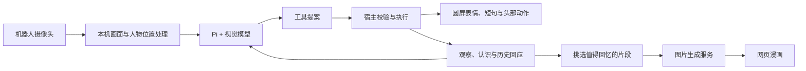

<p align="center">
  
</p>

# 桌面伙伴

**不用先开口，它会留意你，也记得刚才。**

一个放在桌上的无声陪伴机器人。你工作、看书、看看手机，它通过自己的摄像头观察，用眼神、轻微转头和一句短话回应；把实际看到的片段与自己的回应记下来，再将值得回忆的瞬间画成漫画。

[观看真机演示](https://github.com/linght-base/desktop-companion/releases/download/v0.1.0/desktop-companion-real-demo.mp4) · [下载完整工程包](https://github.com/linght-base/desktop-companion/releases/download/v0.1.0/desktop-companion-v0.1.0.zip) · [安装说明](INSTALL.md) · [开发基础](#基于什么开发)

## 真机演示

https://github.com/user-attachments/assets/d2e25285-cc12-4b18-bf37-aabc457fcaa7

[](https://github.com/linght-base/desktop-companion/releases/download/v0.1.0/desktop-companion-real-demo.mp4)

**可直接播放上方视频，也可以点击照片打开视频文件。** 约 41.5 秒，保留实际动作与反馈速度，没有片头片尾。画面已裁去旁边电脑屏幕，保留现场声音。封面插画与控制台仿真图用于说明体验，真机外观和实际反应以这段视频为准。

## 它会怎么陪你

- **留意眼前的人。** 自主观察你和手边的活动，选择眼神、头姿与短句回应。找到人后尽量停在合适位置；持续看不到人时，进入休息并定时检测。
- **接着刚才继续理解。** 上下文包含看到的片段、形成的认识、已做的反馈与相关历史；不是每次看到画面都重新开始。记录和认识可以更正、撤回。
- **表达一点关心与欣赏。** 根据当前画面和前后经历生成短句，避免只播报动作。反应取决于模型和网络，仍可能看错或说得不合适。
- **留下值得回忆的瞬间。** 每半小时尝试从有依据的记录挑一个片段生成漫画，并保留一句鼓励。网页最多展示最近五张，也可以手动触发；没有可靠片段时可以留白。

机器人通过圆屏表情、文字和头部运动互动，目前不使用语音对话。

## 控制台


上图为无个人数据、未连接真机时的界面截图。连接机器人后，“机器人视角”展示它自己的摄像头画面。

| 页面 | 可以做什么 |
| --- | --- |
| 介绍视频 | 看作品介绍短片 |
| 初始化设置 | 连接机器人，填写模型服务、模型名与 API Key，查看连接状态 |
| 陪伴 | 启动或停止陪伴，查看机器人画面、眼神与给你的反馈 |
| 值得回忆 | 查看或手动生成漫画 |
| 如何理解你 | 查看认识、思考依据、实际提示词与上下文 |
| 相处记录 | 查看过去的观察和回应，更正或撤回记错的内容 |

## 基于什么开发

Agent 主体采用 **[Pi Agent Core](https://github.com/earendil-works/pi)**。Pi 负责模型对话、工具调用与推理循环；本项目在它周围实现感知接入、记忆、事件调度、表达和设备执行。

机器人能力通过 **[WatcherRobot Python SDK](https://github.com/orulink-ai/WatcheRobot_python_sdk)** 接入。应用运行在 Mac 上，通过官方应用通道连接机器人。大模型和漫画图片生成调用你配置的模型服务。

### 各部分运行在哪里

| 位置 | 运行的内容 | 需要准备什么 |
| --- | --- | --- |
| 机器人 | 摄像头、圆屏表情与短句、头部动作 | 原有机器人系统和官方 Desktop / SDK 连接能力；本工程不包含机器人固件 |
| 你的 Mac | Pi Agent、记忆库、人物位置检测、网页控制台和设备桥 | 本工程、Node、Python 与官方 SDK；陪伴期间电脑和作品进程需要保持运行 |
| 你选择的模型服务 | 图像理解、Agent 模型推理、漫画图片生成 | 你自己的服务地址、模型和 API Key；不用部署本项目的独立云服务器 |

下载工程包不会附带模型账户或大模型权重，也不是将全部程序安装进机器人后就能脱离电脑运行。

| 部分 | 实际使用的基础 | 在本项目中的用途 |
| --- | --- | --- |
| Agent | `@earendil-works/pi-agent-core` **1.4.0** | 原生 Agent 循环、工具调用、中断与续接 |
| 模型适配 | `@earendil-works/pi-ai` **1.4.0** | 兼容模型调用、图像输入和流式返回 |
| 工具参数 | `typebox` **1.3.27** | 工具参数与数据结构校验 |
| 机器人 | `watcherobot`，本次验证 **0.1.10** | 官方应用启动、连接、摄像头、屏幕、头部动作与关闭 |
| 本机服务 | Node.js，最低 **22.19.0** | 控制台接口、事件与调度、Pi 宿主、设备桥接 |
| 网页 | HTML、CSS、原生 JavaScript | 六页控制台、表情仿真和用户操作 |
| 设备桥 | Python **3.11** | 调用机器人 SDK、画面处理、中文字形和执行回执 |
| 记忆 | Node 内置 SQLite / FTS | 保存观察、经历、认识与文字上下文，按来源检索和修订 |
| 人物位置 | OpenCV YuNet | 本地短期人脸位置与朝向线索，不做身份登记 |
| 画面处理 | aiortc、PyAV、Pillow、OpenCV | 接收和处理机器人实时画面、遮挡、取样与屏幕绘制 |

实际运行过程：



人格和行为提示词位于 `apps/companion-sim/config/`。观察、反馈、相关记忆进入有界上下文，达到阈值后压缩；文字上下文可保存和恢复，原始图像上下文仅保留在内存。认识有依据和修订状态，模型输出仍需要宿主校验后才能执行设备动作。

记忆检索使用本机 SQLite 的全文检索及相关性排序，没有额外的向量数据库或 Embedding 服务依赖。这里的“记得”指保存和检索真实观察、认识与反馈；人设来自可查看的提示词，当前不通过在线训练修改模型权重。

## 开始前需要什么

| 条件 | 要求 |
| --- | --- |
| 电脑 | **Mac**；当前发布版只声明 macOS 支持 |
| 机器人 | WatcherRobot，能进入 Desktop / Python SDK 连接界面；摄像头、圆屏和头部正常 |
| Node.js | 推荐 **Node 24**，最低 **22.19.0**；使用 Node 内置 SQLite |
| Python | 推荐 **Python 3.11**，安装 SDK 与独立画面处理环境 |
| 浏览器 | 现代浏览器；当前控制台在 Chrome 中验证 |
| 网络 | 电脑可连接机器人及所选 AI 服务；首次安装需要下载公开依赖和 YuNet 模型 |
| 模型账户 | 可用的 API Key，模型支持**图像输入和工具调用**；服务调用可能收费 |
| 漫画服务 | 使用 MiniMax 图片生成时，需要对应服务权限；只配视觉模型不等于具备画漫画权限 |

本机不运行视觉大模型权重；模型推理交给配置的服务。项目尚未给出严格的最低内存、CPU 或长时间负载指标，不将开发机能运行等同于所有 Mac 已验证。

### 已固定的 Python 画面依赖

`config/integration/companion-webrtc.requirements.txt` 固定以下版本，由准备脚本装入作品自己的隔离环境：

| 依赖 | 版本 |
| --- | --- |
| aiortc | 1.15.0 |
| PyAV (`av`) | 17.1.0 |
| Pillow | 12.1.0 |
| opencv-python-headless | 4.12.0.88 |
| numpy | 2.2.6 |

人物位置模型为 `face_detection_yunet_2023mar.onnx`，首次准备时从 OpenCV Zoo 下载并核验大小和 SHA-256。来源及许可在 `config/integration/companion-sight-model.json` 和同目录许可文件中。

## 安装与启动

以下命令在**解压后的作品目录**执行。普通体验建议下载 Release 的[完整工程包](https://github.com/linght-base/desktop-companion/releases/download/v0.1.0/desktop-companion-v0.1.0.zip)，其中包含可直接使用的图片和介绍视频。

### 1. 准备环境

先安装 Node 24 和 Python 3.11，确认终端可以运行：

```sh
node --version
python3.11 --version
```

创建运行 SDK 的 Python 环境并安装依赖：

```sh
python3.11 -m venv .venv
.venv/bin/python -m pip install "watcherobot==0.1.10" "Pillow>=12,<13"
.venv/bin/python prepare.py
```

`prepare.py` 会安装锁定的 Node 依赖，创建独立的画面处理环境，下载并检查 YuNet 模型，保存 Node 路径。它不连接机器人、不调用模型，也不带入作者的密钥或相处记录。

### 2. 从官方入口启动

先用 WatcherRobot 完成机器人连接，保持机器人在 Desktop / Python SDK 界面，然后执行：

```sh
.venv/bin/watcherobot app check .
.venv/bin/watcherobot app run .
```

也可以从 WatcherRobot 的应用入口启动已安装的“桌面伙伴”。`app.py` 需要官方启动时注入的应用通道，请使用上述入口，不要直接执行 `python app.py`。

打开 <http://127.0.0.1:8794/>。如果端口已被旧进程占用，先明确停止旧作品，再启动这一份。

### 3. 完成初始化

在“初始化设置”页：

1. 确认机器人已连接；需要时输入机器人当前的六位配对码。
2. 选择模型服务，填写服务地址、模型名称和 API Key。
3. 点击“保存并生效”。保存会暂停陪伴；已保存的 Key 不回填，留空保留，输入新值可替换。
4. 到“陪伴”页点击“启动”。机器人自动开启自己的摄像头，并把画面交给所配置的模型处理。

启动前先把不想分享的内容移出镜头；需要时可以在画面上设置遮挡。设置遮挡后会限制自主头部运动，避免镜头转动使遮挡错位。

## 模型怎么配置

本次默认服务配置：

| 配置 | 值 |
| --- | --- |
| 服务类型 | MiniMax |
| Base URL | `https://api.minimax.cn/v1` |
| 视觉与 Agent 模型 | `MiniMax-M3.1-Flash-Preview` |
| 图片生成模型 | `image-01` |
| API Key | 使用你自己的账户填写，不随工程提供 |

也支持在界面填写 OpenAI 兼容服务。该服务和所选模型需要同时支持图像输入、工具调用与本项目使用的兼容协议；不是填写任意文本模型就能完整体验。MiniMax 路线有单独的推理参数适配，其他服务需要自行确认兼容性。

漫画图片生成当前使用 MiniMax 适配。相同服务地址下可复用 MiniMax Key；切换其他视觉服务时，漫画服务需另行配置。高级配置支持：

- `COMPANION_MODEL_PROVIDER`、`COMPANION_MODEL_BASE_URL`、`COMPANION_MODEL_ID`、`COMPANION_MODEL_API_KEY`：主模型服务。
- `COMPANION_IMAGE_API_KEY`、`COMPANION_IMAGE_BASE_URL`、`COMPANION_IMAGE_MODEL`：漫画图片服务。
- `COMPANION_NODE_PATH`：显式指定 Node 可执行文件。
- `COMPANION_DATA_DIR`：显式指定本作品的数据目录。

这些变量应配置在启动进程的运行环境中。首次体验优先使用网页设置；保存成功只代表设置生效，不代表已验证模型连接。

## 日常怎么用

不用给它布置任务，像平时一样做自己的事，留意眼睛、头部动作和短句。

- **看漫画：** 进入“值得回忆”，或点击“画出最近的瞬间”。生成需要等待，图片是按记录创作的插画，细节可能和现场不同。
- **看它记住了什么：** 进入“如何理解你”和“相处记录”，查看认识、依据和前后的回应；记错了可以更正或撤回。
- **想歇一会儿：** 点击“停止”，回来后再点击“启动”。
- **今天结束：** 点击“停止”，也可以按 Esc；从 WatcherRobot 停止作品会退出本作品启动的程序。

**只关闭网页不会停止真机陪伴。离开前请明确点击“停止”。**

## 数据保存在哪里

官方启动方式默认将数据保存在本机用户目录：

```text
~/Library/Application Support/WatcherRobot/desktop-companion/
├── settings.json       # 模型配置与 API Key
├── runtime.json        # 已确认的 Node 路径
└── companion.sqlite    # 相处记录、认识、文字上下文与漫画等数据
```

配置文件使用受限权限。原始画面不作为录像持续保存，模型请求所需的图像短窗保存在内存；开启分享后，所选模型服务会收到相关画面与文字上下文，其处理和保留方式遵循对应服务条款。不采集机器人音频。

不要把这个用户数据目录、模型 Key、数据库或私人漫画放进公开代码仓库。工程包和公开仓库不附带这些数据。

## 项目目录与开发入口

```text
app.py / app.json                官方应用入口与描述
launcher.py / host.mjs            Python 启动监督与本机 Node 服务
managed_device.py                官方应用通道与设备桥接
prepare.py                       首次准备和本机配置
apps/companion-sim/
├── src/agent.mjs                 Pi 主体接入
├── src/controller.mjs            生命周期、事件与工具执行宿主
├── src/provider.mjs              视觉模型服务适配
├── src/continuity-store.mjs      观察、经历、认识与检索
├── src/pi-context-store.mjs      文字上下文持久化
├── src/moment-comics.mjs         漫画任务与记录
├── src/comic-image-provider.mjs  图片生成服务
├── config/                      人设、陪伴与漫画提示词
└── web/                         六页控制台、表情与页面交互
scripts/                         SDK 设备桥、画面处理和圆屏文字
config/integration/              隔离依赖与人物位置模型来源
```

开发者从 Git 克隆时需要 Git LFS 拉取媒体资源；Release 工程包已经包含实际媒体字节。修改人设和行为从 `apps/companion-sim/config/` 入手，调整 Agent 工具从 `src/agent.mjs` 和宿主模块入手；设备动作最终由宿主校验并通过官方 SDK 执行。

## 当前限制与验证范围

- 目前只声明 Mac 支持；公开包需要使用者自己的机器人、网络和模型账户，不能只打开网页就获得完整真机体验。
- 视觉理解、人物位置与朝向是有误差的线索，不是身份确认、精确眼动追踪或情绪诊断。反馈速度受模型和网络影响。
- 头部姿态主要反映下发目标，不能仅凭设备回执断言机械动作完全达到预期。
- 健康提醒、机器人圆屏滑动看漫画暂未开放；漫画在网页查看。
- 软件链路、记忆和压缩已实现，不等于已完成所有长期陪伴、开放场景或自学习效果验收。
- 本次发布准备已完成 Node **655** 项、Python **252** 项回归，独立目录安装 Node 依赖与加载 Pi 通过，官方应用文件检查通过。
- 官方应用托管下的真机全流程、全新机器安装和长时间压力体验仍需继续验证；真机演示视频展示的是已实际运行的片段。

## 遇到问题

| 情况 | 先检查什么 |
| --- | --- |
| 页面打不开 | Node 是否可用、作品是否从官方入口启动、8794 端口是否被占用 |
| 提示缺少依赖 | 是否在作品目录用正确的 Python 完整执行过 `prepare.py` |
| 显示未连接 | 机器人是否在线、是否在 Desktop / SDK 界面、当前配对码是否正确 |
| 看不到画面 | 是否已在“陪伴”页点击“启动”，初始化页是否仍显示机器人在线 |
| 有眼睛但没有回应 | 模型是否支持图像与工具调用、Key 和额度是否可用、网络是否正常 |
| 无法生成漫画 | 是否已有可靠记录、是否具备图片服务权限、图片服务 Key 是否配置 |
| 修改配置后不再观察 | 保存模型设置会暂停陪伴，需要重新点击“启动” |

[Apache-2.0](LICENSE) · [第三方组件与素材来源](THIRD_PARTY_NOTICES.md) · [更详细的安装说明](INSTALL.md)
